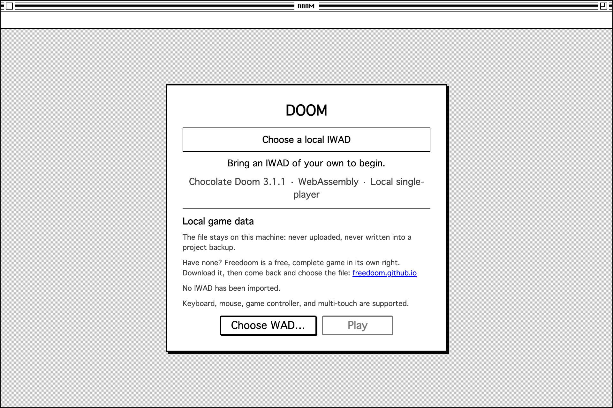
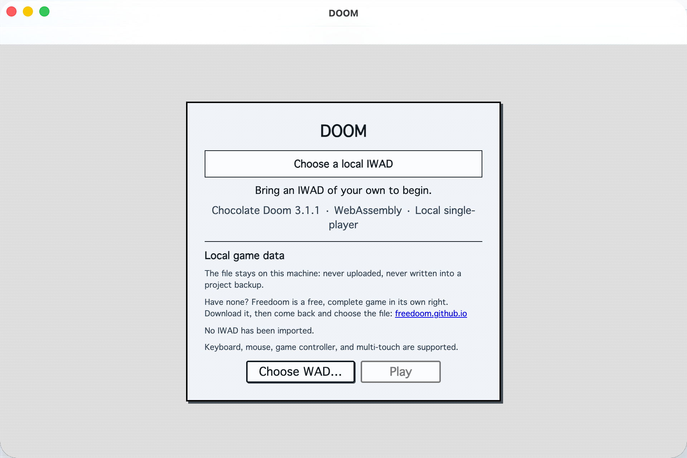

# Chocolate Doom (web)

A browser page that runs [Chocolate Doom](https://github.com/chocolate-doom/chocolate-doom) 3.1.1 as WebAssembly (`SOURCE.txt`; `index.html` shows “Chocolate Doom 3.1.1 · WebAssembly”).

## Screenshots

Captured running inside the AI System 6 desk: Classic on the left, Liquid Glass on the right.

<p> </p>

No DOOM, DOOM II, TNT, Plutonia, Freedoom, or other WAD is included or downloaded (`SOURCE.txt`). You choose a local IWAD through the page’s file picker. A selected IWAD stays in the page’s own browser storage (`SOURCE.txt`).

Saves, configuration, and imported WAD copies live in the engine’s IDBFS under `/doom/iwads`, `/doom/saves`, and `/doom/config` (`build/build.md`; `shell.js` mounts IDBFS at `/doom`).

## Run on its own page

```bash
npm start
```

Then open `http://localhost:8080/`.

The page loads `wad-picker.js`, `touch-controls.js`, `ais6-bridge.js`, and `shell.js` (`index.html`). `shell.js` then loads `chocolate-doom.js`, which fetches `chocolate-doom.wasm`. With no host, the same bridge calls are answered by the standalone adapter in `ais6-bridge.js`.

## Build

```bash
npm run build
```

Copies what a host page embeds into `dist/`. It does not recompile the engine. Node is enough; there are no package dependencies.

To rebuild `chocolate-doom.js` and `chocolate-doom.wasm` from source, follow `build/build.md` (Emscripten 3.1.57; `build/build-doom.sh`). The unmodified upstream source is `chocolate-doom-3.1.1-source.tar.gz`; the native patch is `chocolate-doom-3.1.1-ai-system6.patch` (same bytes as `build/patches/emscripten-runtime.patch`). Engine licence text is `ENGINE-COPYING.txt` (`SOURCE.txt`).

## Layout

| Path | What it is |
| --- | --- |
| `index.html` | The page: WAD picker UI, canvas, touch root |
| `shell.js` | Starts the engine, IDBFS, bridge status |
| `wad-picker.js` | Local IWAD import and catalog |
| `touch-controls.js`, `touch-controls.css` | Touch / controller overlay |
| `chocolate-doom.js`, `chocolate-doom.wasm` | Committed Chocolate Doom 3.1.1 Wasm build |
| `chocolate-doom-3.1.1-source.tar.gz` | Unmodified upstream source for this build |
| `chocolate-doom-3.1.1-ai-system6.patch` | Native patch applied for this build |
| `ENGINE-COPYING.txt` | Chocolate Doom / GPL-2 licence text |
| `SOURCE.txt` | Engine version, adapters, WAD and storage boundary |
| `build/` | Rebuild script, notes, and `patches/` |
| `ais6-bridge.js`, `app.manifest.json` | Let a host page embed the game in a frame and draw its window and menus; on its own page the same calls fall back to the bridge’s standalone adapter |

## Licence

GNU GPL version 2. See `ENGINE-COPYING.txt` and `SOURCE.txt`. Adapter files are marked `GPL-2.0-only` in their headers (`SOURCE.txt`). Further notes: [LICENSE-NOTES.md](LICENSE-NOTES.md).

中文说明见 [README.zh-CN.md](README.zh-CN.md).
