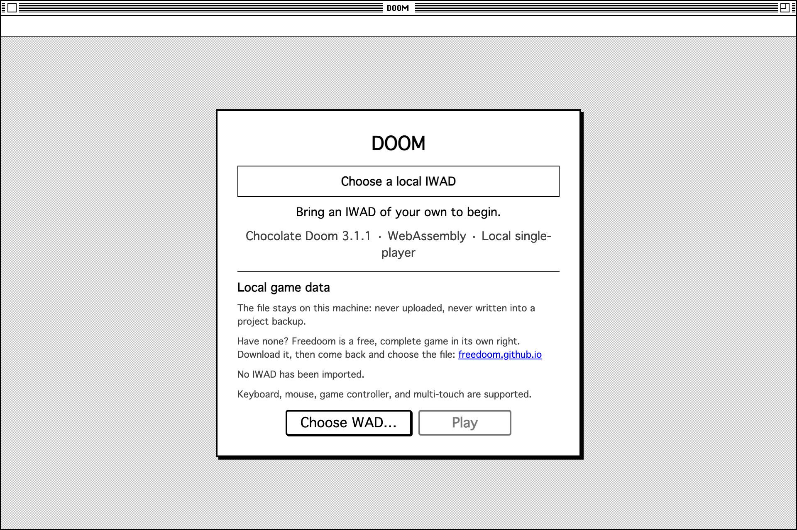
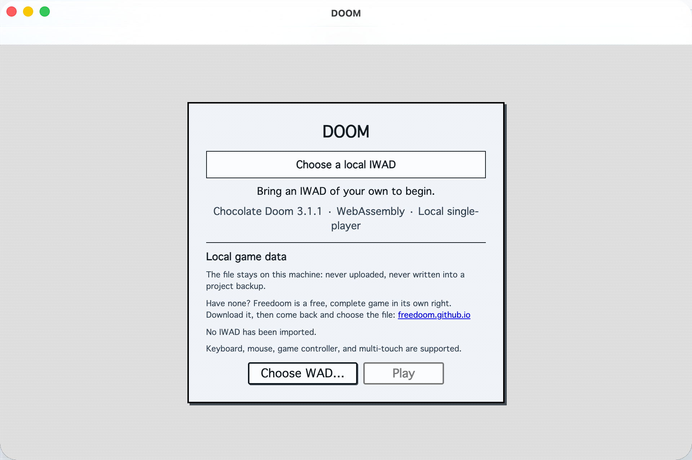

# Chocolate Doom（网页）

在浏览器页面里运行 [Chocolate Doom](https://github.com/chocolate-doom/chocolate-doom) 3.1.1 的 WebAssembly 构建（见 `SOURCE.txt`；`index.html` 写明「Chocolate Doom 3.1.1 · WebAssembly」）。

## 截图

在 AI System 6 桌面里实际运行时截取，左为 Classic，右为 Liquid Glass。

<p> </p>

不包含、也不下载 DOOM、DOOM II、TNT、Plutonia、Freedoom 或其它任何 WAD（`SOURCE.txt`）。你通过页面的文件选择器提供本机 IWAD。所选 IWAD 留在页面自己的浏览器存储里（`SOURCE.txt`）。

存档、配置与已导入的 WAD 副本保存在引擎的 IDBFS，路径为 `/doom/iwads`、`/doom/saves`、`/doom/config`（`build/build.md`；`shell.js` 把 IDBFS 挂在 `/doom`）。

## 单独打开页面

```bash
npm start
```

然后打开 `http://localhost:8080/`。

页面加载 `wad-picker.js`、`touch-controls.js`、`ais6-bridge.js`、`shell.js`（`index.html`）。`shell.js` 再加载 `chocolate-doom.js`，由它拉取 `chocolate-doom.wasm`。没有宿主时，同样的桥接调用由 `ais6-bridge.js` 的独立适配器应答。

## 构建

```bash
npm run build
```

把宿主页面要嵌入的文件复制到 `dist/`。不重新编译引擎。没有依赖，有 Node 即可。

若要从源码重建 `chocolate-doom.js` 与 `chocolate-doom.wasm`，按 `build/build.md`（Emscripten 3.1.57；`build/build-doom.sh`）。未改动的上游源码为 `chocolate-doom-3.1.1-source.tar.gz`；原生补丁为 `chocolate-doom-3.1.1-ai-system6.patch`（与 `build/patches/emscripten-runtime.patch` 同内容）。引擎许可文本为 `ENGINE-COPYING.txt`（`SOURCE.txt`）。

## 目录

| 路径 | 内容 |
| --- | --- |
| `index.html` | 页面：WAD 选择界面、画布、触控根节点 |
| `shell.js` | 启动引擎、IDBFS、桥接状态 |
| `wad-picker.js` | 本机 IWAD 导入与目录 |
| `touch-controls.js`、`touch-controls.css` | 触控／手柄层 |
| `chocolate-doom.js`、`chocolate-doom.wasm` | 已提交的 Chocolate Doom 3.1.1 Wasm 构建 |
| `chocolate-doom-3.1.1-source.tar.gz` | 本构建对应的未改动上游源码 |
| `chocolate-doom-3.1.1-ai-system6.patch` | 本构建使用的原生补丁 |
| `ENGINE-COPYING.txt` | Chocolate Doom／GPL-2 许可文本 |
| `SOURCE.txt` | 引擎版本、适配器、WAD 与存储边界 |
| `build/` | 重建脚本、说明与 `patches/` |
| `ais6-bridge.js`、`app.manifest.json` | 让宿主页面把游戏嵌进框架并画出窗口与菜单；单独打开时，同样的调用退回桥接的独立适配器 |

## 许可

GNU GPL 第 2 版，见 `ENGINE-COPYING.txt` 与 `SOURCE.txt`。适配器文件头标记为 `GPL-2.0-only`（`SOURCE.txt`）。更多说明见 [LICENSE-NOTES.md](LICENSE-NOTES.md)。

English: [README.md](README.md).
